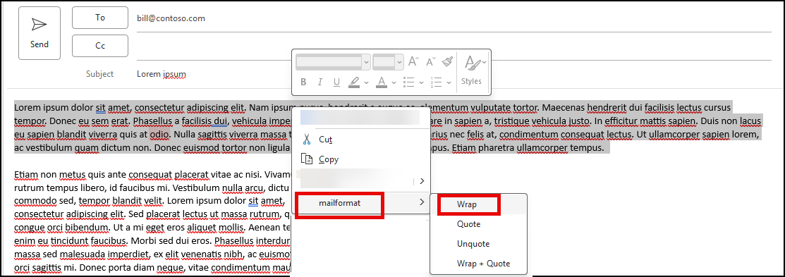

# outlook-mailformat

A small MS Outlook (Classic) add-in that formats selected text in an email in mailing-list style: 72-character lines and `>` quoting. Same as [chrome-mailformat](https://github.com/christian-korneck/chrome-mailformat), but inside of Outlook.

A small COM add-in (C#, no deps).

## Install

Download `mailformat-<version>.zip` from [releases](https://github.com/christian-korneck/outlook-mailformat/releases/latest) and extract it. Close
Outlook and run `install.cmd` (as regular user, non-elevated). Works on amd64 and arm64 Windows.

Installation is per user (no admin privs required, target dir is in the user profile: `%LOCALAPPDATA%\mailformat`).

## How to use

Select text in a mail you're writing, then select `mailformat` on the
Outlook `Message` tab or in the right-click menu (context menu).

Features:    
- **Wrap**: Wrap lines to max. 72 characters line length
- **Quote**: Add one level of `> ` quotation
- **Unquote**: Remove one level of `> ` quotation
- **Wrap + Quote**": Both combined
- (the max line length for wrapping is `72`, can be changed by clicking on: `Message` tab -> `mailformat` -> `width`)

## Build and install from source

Close Outlook, then run `build.cmd` and `install.cmd`.

It builds and copies the add-in to `%LOCALAPPDATA%\mailformat` and registers the add-in from there for
the current user.

## Uninstall

Close Outlook and either run `uninstall.cmd` or uninstall via the usual Windows Uninstall GUI (`appwiz.cpl`).

